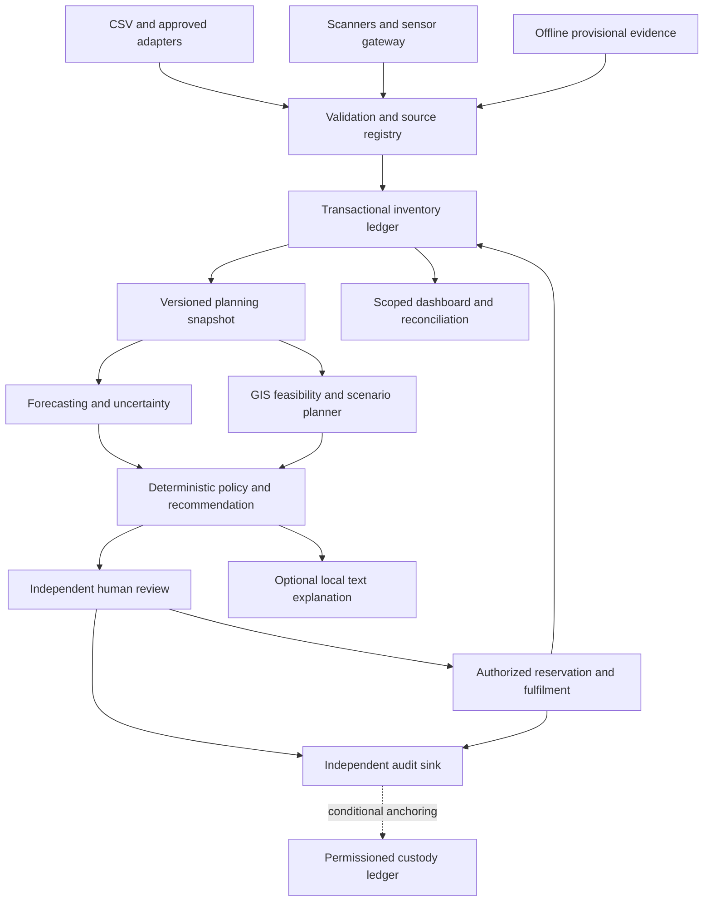

# Setu Supply — Predictive Logistics & Supply Assurance

**Final product and implementation proposal | SIH26251 | 20 October 2026**
**Working name:** Setu Supply; no trademark or exclusivity claim.
**Status:** Proposed architecture and evaluation plan. No implementation, performance, accreditation or sponsor endorsement is asserted by this document.

## 1. Executive proposal

Build an offline-capable, human-supervised supply decision-support product that combines four core capabilities: **AI/ML demand forecasting, GIS logistics planning, IoT inventory evidence and integrated logistics management**. Its defining workflow is evidence → forecast → feasible supply proposal → independent approval → dispatch/receipt evidence → reconciliation → measured outcome.

The product tells a reviewer what stock is usable, how trustworthy and recent the evidence is, when shortages may emerge, which general-supply replenishment options satisfy declared constraints, and what was ultimately received. Forecasts and language models cannot create stock or authorize execution.

The initial demonstration uses fictional depots, synthetic ordinary-supply demand and an invented transport graph. It covers food, drinking water, clothing and basic medical consumables. Medical stock disposition requires separate quality authority; the product does not prescribe treatment. Operational convoy planning, adversary-aware routing, weapons allocation and classified feeds are outside the proposed demonstration.

**Architecture decision:** one modular application, one authoritative inventory transaction boundary, replaceable forecasting and planning modules, deterministic server-side policy, and independent human approval. A local SLM/LLM is an optional explanation interface. Permissioned blockchain is a conditional later experiment only where independent organisations need shared custody evidence and accept its governance costs.

**Submission sentence:** “Setu Supply joins uncertainty-aware forecasting, constraint-aware GIS planning and authenticated inventory evidence in one accountable replenishment workflow, with offline evidence capture and human-controlled execution.”

## 2. Evidence, scope and foundation alignment

### Inputs actually available

- The supplied conversation establishes the four priorities and asks that LLM, blockchain and deterministic policy be considered as additions.
- The attachment `SIH26251_Foundation.md` was recovered through the referenced conversation. The Linux-style path `/mnt/data/SIH26251_Foundation.md` was not the available local location; the attached file of that name was read instead.
- The foundation reports a screenshot identifying SIH26251, Indian Army Predictive Logistics & Forward Supply Chain, Ministry of Defence / Defence Services Staff College. The screenshot itself was not independently inspected in this continuation. Confirm final identifiers, template and submission rules against the official brief before submission.
- Earlier assistant answers are cached as unresolved content references. They were not reconstructed or treated as researched findings.
- The foundation summarises Colonel Munish Tuli’s *Predictive Military Logistics: A Data-Driven Approach*, CLAWS Manekshaw Paper 104 (2024). Its PDF was not independently reread here. Paper-specific page claims remain attributed to the foundation; the paper is author analysis, not an Army deployment mandate.

### What this proposal preserves and changes

| Foundation decision | Final treatment | Reason |
|---|---|---|
| Authoritative event ledger, batch accounting and human approvals | Preserve | Physical accountability must survive model failure |
| Source registry, custodian and snapshot lineage | Preserve | Conflicting sources need explicit authority |
| Seasonal-naive/EWMA baseline | Preserve; add intermittent/quantile challengers later | Establish honest comparative evidence first |
| Fictional site view and manual delay scenarios | Expand into a constrained GIS planning work package | GIS planning must have measurable behaviour beyond plotting markers |
| Simulated capture | Expand into IoT gateway, device lifecycle and hardware-validation plan | A simulator demonstrates software integration, not physical tracking performance |
| Offline evidence, no offline shared reservation | Preserve | Avoid allocating the same cached stock twice |
| No last-minute LLM/blockchain dependency | Preserve for core build; specify gated extensions | Complexity must earn its place through evidence |
| Two-hour compressed build | Retain as an emergency fallback; add a realistic multiweek plan | A two-hour slice cannot substantiate all four opportunities |

This is an extension of the foundation, not a claim that the extensions have been implemented. If only its narrow prototype exists, describe GIS and hardware IoT as planned or simulated, respectively.

## 3. Requirements and demonstrable outcomes

| SIH opportunity | Product behaviour | Minimum convincing demonstration | Later evidence required |
|---|---|---|---|
| AI/ML forecasting | Predict item/site demand and uncertainty, track bias and evidence quality | Chronological holdout against seasonal-naive/EWMA; reproducible model run | Sponsor-approved history, actual unmet demand, drift monitoring |
| GIS logistics planning | Compare replenishment sources and feasible paths on an approved graph | Fictional graph with capacity and delay constraints; blocked-edge scenario changes feasible plan | Approved geospatial sources, restrictions, validated lead times and operator acceptance |
| IoT inventory tracking | Convert scans and sensor observations into attributable inventory evidence | Duplicate-safe scan plus labelled sensor simulator feeding the workflow | Real reader tests, authenticated gateway, calibration and false-read evaluation |
| Integrated predictive management | Link evidence, plans, authorization, fulfilment and review | One traceable record from import to partial receipt and reconciliation | Approved adapters, authority mapping, operating procedures and recovery tests |

Extra layers are subordinate: deterministic policy is required; local text assistance is optional; blockchain is conditional. A disabled assistant or ledger extension must not disable any core opportunity.

## 4. Users, operating assumptions and boundaries

**Roles:** storekeeper captures evidence; planner reviews forecasts and alternatives; approver accepts or rejects supply requests; dispatcher records authorized handover; receiver records quantity and condition; QA authority releases restricted stock; data custodian resolves mappings and quality; auditor reviews scoped history; administrator manages infrastructure without ordinary business approval privileges.

Roles are separate permissions, not necessarily separate full-time posts. The sponsor must define delegation and separation-of-duty requirements. A demo can use separate accounts; production needs approved identity integration.

Plan for low bandwidth, intermittent links, power interruptions, inconsistent units, sparse histories, delayed physical counts, limited device maintenance and users who need concise explanations. These are design assumptions to validate with stakeholders, not claims about every Indian military installation.

The product complements approved systems of record. It does not assume access to IQMP, CICP, MISO, Army networks or an Army cloud. Existing systems may remain authoritative; the prototype’s ledger is authoritative only inside its synthetic demonstration.

## 5. End-to-end operational workflow

1. **Register authority.** Define item/site codes, base units, pack conversion versions, expiry/quality rules, source owners, access compartments and who can approve each action.
2. **Establish opening balances.** Import an approved physical count and record its date, source and authorizer. Unknown mappings go to quarantine, not guessed conversions.
3. **Capture evidence.** Record receipt/issue/return scans and sensor observations with device identity, sequence and observed time. A scan identifies an object; it does not alone prove count, quality or custody transfer.
4. **Validate and reconcile.** Deduplicate events; check units, authorizations and plausible bounds. Keep requested, issued, consumed and unmet quantities separate. Show rejected inputs and source conflicts.
5. **Assess freshness.** Display last physical count, last observation and last synchronization independently. Missing dates are not zero demand. Stockout-suppressed issues are not proof of low need.
6. **Freeze a planning snapshot.** Bind inventory, demand cutoff, source versions, transport graph, known constraints and policy version. Every comparison refers to that same snapshot.
7. **Forecast demand.** Route each series to a supported baseline or validated challenger. Generate aggregate lead-time demand scenarios, with the method and uncertainty limitations visible.
8. **Project dated stock.** Include expiration, reservations, confirmed inbound and outstanding obligations once each. Show shortage days and capacity violations.
9. **Compare GIS options.** Evaluate feasible source/arrival combinations on a fictional or approved graph. Manual closures and weather-delay assumptions must be visibly labelled scenarios. Report unmet demand when no feasible plan exists.
10. **Draft recommendation.** Present quantity, source, expected arrival, assumptions, data age, alternatives, constraint results and expected service/inventory tradeoff. Nothing moves merely because a model suggested it.
11. **Review independently.** The server checks creator/approver separation, authority, current versions and policy again. A changed record can invalidate the proposal; approval is not a guarantee of physical delivery.
12. **Commit authorized reservation.** Reserve atomically against current allocatable stock. Two concurrent requests cannot both obtain the same last units. No authoritative shared-stock reservation while disconnected.
13. **Record dispatch.** Link actual dispatched batches/quantities to the authorized request. Preserve partial dispatch and cancellation history.
14. **Receive and reconcile.** Capture partial receipts and condition, offline provisionally if needed. Accepted usable stock, quarantine and rejected quantities remain distinct. Close shortages/damage only through reconciliation or an authorized exception.
15. **Learn from outcomes.** Compare expected with actual arrival, demand, shortage, expiry and reviewer overrides. New data does not automatically retrain or promote a model.

### Illustrative replenishment calculation

For a synthetic item measured in packs: expected demand over lead time plus review period is 100; declared policy buffer is 20; allocatable stock is 50; confirmed inbound within the horizon is 10. Assuming expiry and commitments have already been handled consistently, the draft is `max(0, 100 + 20 - 50 - 10) = 60 packs`.

If storage has room for only 40 additional packs, show the 20-pack gap and propose an explicitly reviewed split-arrival alternative. Do not silently exceed capacity. If using a calibrated upper-demand target instead of expected demand plus buffer, avoid adding a second unexplained uncertainty buffer. A dated simulation takes precedence over this simplified scalar example when expiry or arrival timing matters.

## 6. Architecture and module boundaries



Identity and access enforcement apply to every API, query and export, including retrieval for the assistant; the diagram omits these repeated edges for readability.

| Module | Responsibilities | Must not do |
|---|---|---|
| Source/adapter registry | Mapping, provenance, ownership, import preview and validation | Invent a sponsor interface or silently overwrite authoritative fields |
| Inventory | Batch ledger, projections, reservations, receipts and corrections | Treat forecast as a physical event |
| Forecast | Reproducible runs, baselines, challenger evaluation and uncertainty | Authorize orders or hide missing evidence |
| GIS planner | Feasibility, alternatives, dated capacity/lead-time assumptions | Claim operational route safety or live weather without a source |
| IoT gateway | Authenticated ingestion, sequence/replay checks, buffering and device status | Trust every RFID read as a unique physical item |
| Policy | Versioned hard constraints, approval requirements and explicit exceptions | Allow UI or model to bypass server rules |
| Workbench | Exceptions, evidence, recommendations and reviewer actions | Present stale cache as current truth |
| Sync | Idempotent provisional evidence replay and conflict reporting | Last-write-wins stock balance replacement |
| Audit/evaluation | Decision lineage, protected history, metrics and experiment records | Claim an application-only log is administrator-proof |

### Practical stack and deployment progression

- **Prototype:** familiar React/TypeScript UI, FastAPI/Pydantic, SQLite with one API writer, Python baseline forecasting, local GeoJSON/fictional graph, simulated scanner/sensor adapter. Bundle fonts, maps and assets locally.
- **Team MVP:** PostgreSQL for concurrent transactions, locally hosted application, MapLibre with licensed offline assets where needed, a constrained graph/optimization library and an MQTT-capable gateway if hardware warrants it. Pin dependencies and verify selected versions/licenses during implementation.
- **Pilot direction:** sponsor-approved hosting and identity, managed devices, protected keys, signed artifacts, approved integration adapters, separate audit storage and tested backup/recovery. A dedicated model process is optional; microservices, Kafka and Kubernetes are not prerequisites.

Use a transactional outbox if database commits must reliably trigger downstream notifications. A device broker delivers observations; it is not the stock authority. No public model endpoint, external map query, CDN or analytics dependency is required at runtime.

## 7. Forecasting and GIS design

### Forecasting

Begin with seasonal-naive where history supports the seasonal period and EWMA otherwise. Evaluate intermittent-demand methods such as Croston-SBA/TSB and a tabular quantile model only after baselines work. Sparse series use a documented pooled/manual fallback with a low-evidence flag. Large pretrained time-series models are research challengers, not dependencies or presumed improvements.

Train using information available at the historical cutoff. Fit transformations only on training data. Do not substitute realized future weather for the forecast known then. Save dataset fingerprint, cutoff, feature definition, model version, seed, library versions and evaluation configuration.

Estimate aggregate demand for the lead-time horizon directly or through joint trajectories. Summing daily 90th percentiles does not produce a valid 90th percentile of cumulative demand. Label uncalibrated bands as scenario envelopes. Check coverage by horizon/item group and investigate systematic bias. Fallback remains available when inference fails or evidence becomes stale.

### GIS planning

The first real planner is a small capacity-constrained **general freight replenishment** model over an invented graph. Nodes represent fictional warehouses/service sites; edges contain declared transit time, capacity and availability. Quantities must use compatible base units and item-specific mass/volume conversions.

Inputs include candidate source stock, approved receiving windows, transport/storage capacity, arrival assumptions and scenario closures. Outputs include feasible source allocation, path references, quantities, expected arrival, binding constraints, unmet amount and the exact graph/scenario version.

Use a transparent objective such as weighted shortage penalty plus declared transport cost and expiry penalty. Report each component and the weights; these are prototype choices, not military priorities. Start with shortest feasible paths and a small allocation model; expand only after correctness checks. A timeout must return a labelled feasible incumbent or “no plan established,” not a false optimum.

Compare the planner with a simple nearest-feasible-source baseline on the same graph and resources. Test a closed edge, reduced vehicle capacity and a delayed arrival. A map must explain why a feasible allocation changed; markers alone do not demonstrate logistics planning.

Real terrain, restrictions and geospatial precision require approved data, scope and policy review. The product does not infer tactical safety, adversary exposure or convoy instructions from public maps.

## 8. IoT capture and physical-truth controls

Use barcode/QR for the first hardware slice; add RFID only when the sponsor’s process and equipment justify it. Temperature/humidity observations may support quality review but do not automatically establish fitness for use.

1. Provision device and gateway identities through an approved registration process.
2. Bind readings to item/batch identifiers and a location scope; prevent operators assigning arbitrary site authority.
3. Include event ID, monotonic sequence or boot-session/sequence pair, observed time, gateway-received time, unit and calibration status.
4. Authenticate the gateway; validate device origin as supported by the hardware. A gateway signature proves gateway attribution, not that a weak downstream sensor was uncompromised.
5. Detect duplicates, implausible rates, impossible units, stale readings and sequence gaps. Quarantine uncertainty for review.
6. Store-and-forward across link loss with bounded queue size; raise a visible gap alert on overflow.
7. Require the authorized business event for stock mutation. Repeated RFID detections are observations, not repeated receipts.
8. Keep a manual count/reconciliation path when readers fail.

The SIH demo must label simulated sensor events. A physical prototype should report read success/false reads under defined distance, packaging, interference and power conditions; a single successful scan is not a reliability result. Cold-chain threshold and excursion-release rules must come from the designated authority, not a model guess.

## 9. Deterministic policy engine

Implement policy as a versioned server-side decision function. Inputs are authenticated actor/scope, current object version, stock state, recommendation snapshot and approved policy configuration. Output is `ALLOW`, `DENY` or `REQUIRES_REVIEW`, with reason codes and required approvers.

Hard checks include creator/approver separation, site/role authority, nonnegative valid quantities, pack conversion, allocatable stock, batch quality, expiry, storage/transport feasibility, freshness thresholds and receipt totals. Exact thresholds and delegations are sponsor configuration. Operational users cannot bypass a hard rule through free-text instructions.

An exception is a separate authorized action with reason, expiry, scope and an audit record. Legal/access restrictions and stock-accounting invariants are not ordinary user overrides. Recompute policy at commit time; a valid draft can become stale before approval. Preserve policy versions so later reviewers can reproduce why a decision was permitted.

## 10. Optional local SLM/LLM and conditional blockchain

### Local language assistant: optional explanation layer

Useful tasks: explain a structured recommendation in plain language, answer permitted SOP questions with document/version references, summarize an exception, or translate approved interface explanations for review. The deterministic template explanation must remain the default fallback.

Retrieval is filtered by role, compartment and document validity **before** model context assembly. Documents and user text are untrusted data; instructions within them cannot expand privileges. The model has no mutation tools, approval credentials or unrestricted database/network access. Render its answers as advisory, show cited records and support “insufficient evidence.” Numeric answers must reference validated structured fields rather than model arithmetic.

Select a locally runnable model only after testing task quality, RAM/latency, license, provenance, packaging and offline operation on the actual target hardware. A smaller model may be adequate; neither a parameter count nor local hosting guarantees confidentiality or correctness. Measure fabricated citations, wrong quantities, unauthorized disclosures, prompt-injection resistance and user task time. Do not fine-tune on sensitive records without approval.

**Adoption gate:** keep the assistant only if it measurably improves explanation/retrieval without increasing disclosure or decision errors. It is not necessary to satisfy the four opportunities.

### Permissioned blockchain: conditional custody experiment

Default to the authoritative database plus signed evidence and an independently controlled append-only audit sink. Blockchain is justified only if independent custodians genuinely need shared verification, no accepted single audit custodian exists, participants can operate validators, and governance for admission, revocation, disputes, upgrades and recovery is agreed.

If that gate passes, trial a permissioned ledger for **custody acknowledgement digests**, not full inventory, personal data, locations or forecasts. Keep encrypted detailed evidence off-chain; use canonical payloads, signatures and context-bound commitments. Plain hashes of predictable low-entropy records can leak through guessing; design commitments and metadata minimization accordingly.

Inventory transactions remain valid under the database’s authority; ledger anchoring is asynchronous with explicit pending/failed status. No validator quorum means shared-ledger progress may stop. It must not freeze ordinary local evidence capture or pretend that unsynchronized acknowledgements are final. Corrections add linked records rather than deleting history.

Compare it experimentally against signed append-only logs for latency, disconnected recovery, operational cost and dispute verification. Consensus cannot prove a sensor reading true, prevent colluding signers, reverse key compromise or fix bad data. A single organisation controlling all validators offers little additional trust separation. Avoid the phrase “tamper-proof blockchain.”

## 11. Data contracts and APIs

### Common contract rules

Use schema versions, immutable UUID-style identifiers, UTC timestamps with explicit offsets on input, base-unit quantities with fixed precision, and canonical serialization for signatures. Store observation time separately from receipt/server time; neither device clocks nor GPS are unquestioned truth. Enforce payload size limits and item/unit mappings. Retain origin and correlation ID through the entire workflow.

| Entity | Minimum fields |
|---|---|
| Item | item_id, base_unit, pack_conversion_version, mass/volume conversion, expiry_required, quality_policy |
| Site/source | site_id, access_scope, custodian_id; source_id, authoritative_fields, owner, permitted_use, freshness/retention policy |
| Batch | batch_id, item_id, expiry_date, quality_state |
| Inventory event | event_id, client_event_id, schema_version, site_id, item_id, batch_id, event_type, quantity_base, source_ref, actor_id, occurred_at, recorded_at, expected_version |
| Demand | site_id, item_id, period, requested, issued, consumed_if_known, returned, unmet, missing_flag, stockout_flag |
| IoT observation | event_id, device_id, boot_session, sequence, item/batch_ref, observation_type, value, unit, occurred_at, gateway_time, calibration_status, origin_evidence |
| Forecast run | run_id, input_snapshot_id, cutoff, horizon, model_version, predictions, range_method, evaluation_ref, warnings |
| GIS plan | plan_id, snapshot_id, graph_version, scenario_id, constraints_version, allocations, path_refs, arrival_assumptions, unmet, objective_components, solver_status |
| Recommendation | recommendation_id, run_id, plan_id, policy_version, input_version, proposed_qty, explanation_fields, status |
| Approval/fulfilment | decision_id, request_id, actor, reason, server_time; shipment/line IDs, dispatched quantity; receipt_part_id and dispositions |
| Audit | actor, action, scoped_object_ref, before/after_version, outcome, reason, correlation_id, server_time |

Example provisional observation, with invented identifiers:

```json
{
  "schema_version": "1.0",
  "event_id": "evt-demo-00042",
  "device_id": "scanner-demo-01",
  "boot_session": "boot-demo-03",
  "sequence": 42,
  "site_id": "FICTIONAL-A",
  "batch_id": "BATCH-DEMO-7",
  "observation_type": "barcode_seen",
  "occurred_at": "2026-10-20T08:00:00Z",
  "gateway_time": "2026-10-20T08:00:02Z",
  "status": "PROVISIONAL"
}
```

This record does not contain sufficient authority or quantity to create a receipt. Authentication evidence is established by the transport/device verification process, not a self-asserted actor field.

### Accounting invariants

- Physical on-hand includes unusable goods. Quality-unavailable is the **union** of expired, damaged and quarantined goods; overlapping classifications are not subtracted twice.
- Usable = physical minus quality-unavailable. Allocatable = usable minus active reservations. Confirmed inbound remains separate until receipt.
- Do not double-count committed outbound in both reservations and forecast depletion. Document whether the forecast is total demand or incremental uncommitted demand.
- Append ledger event, update projection/version and persist idempotency result atomically.
- Same idempotency key and same payload returns the original result; same key with different payload is rejected.
- Corrections use compensating events with authority, never silent history edits.
- Partial receipts use different receipt-part IDs; retries reuse the original ID.
- Accepted, damaged and rejected dispositions partition each received part. Quarantine is a status on physical goods, not another additive receipt quantity.
- Cumulative physical received quantities cannot exceed dispatched quantity without an explicit discrepancy process.

### API boundary

| Endpoint | Contract purpose |
|---|---|
| POST /api/v1/imports/validate and /commit | Preview then commit a versioned import once |
| GET /api/v1/inventory | Scoped quantities, timestamps and versions |
| POST /api/v1/inventory-events | Authorized transactional mutation |
| POST /api/v1/observations | Device/gateway observations; separate from stock mutation |
| POST /api/v1/forecast-runs | Frozen-snapshot forecast |
| POST /api/v1/planning-runs | Versioned graph/scenario feasibility |
| POST /api/v1/recommendations | Policy-checked draft only |
| POST /api/v1/requests/{id}/approve | Independent authority and fresh-state revalidation |
| POST /api/v1/requests/{id}/reserve | Atomic authorized reservation |
| POST /api/v1/shipments/{id}/dispatch-record | Actual handover evidence |
| POST /api/v1/shipments/{id}/receipt-parts | Partial receipt with deduplication |
| POST /api/v1/sync | Per-event accepted/rejected/conflict outcome |
| GET /api/v1/audit | Scoped review history |

Errors: `{code, message, field_errors, correlation_id, current_version}`; 403 denied scope, 409 stale/conflicting state, 422 invalid input. Avoid leaking inaccessible records in errors. Require idempotency keys for retryable mutations and version checks for state-dependent actions.

Request states: DRAFT → SUBMITTED → APPROVED/REJECTED; cancellation where permitted. Reservations have a separate lifecycle. Shipments: CREATED → DISPATCH_RECORDED → PARTIALLY_RECEIVED → RECONCILED, with explicit exception closure. “Approved” is never synonymous with “received.”

## 12. Offline operation and recovery

While connected, the server enforces identity, scope, versions and stock invariants. During disconnection, show the cached snapshot timestamp prominently and permit only scoped provisional evidence and drafts within the approved cached authorization lifetime. Do not approve shared reservations or promise another site’s cached stock.

On reconnect, refresh revocation/identity state, replay immutable event IDs, and show each accepted/rejected/conflicting result. Rejected evidence stays available to authorized reviewers. Sync order and late-arriving observations must not silently rewrite historical balances; record observed and posted times separately.

After cached authorization expires, do not keep showing protected cached records. A blank minimal evidence form may support supervised later reconciliation if approved. A stolen disconnected device cannot be instantly revoked; minimize cache, encrypt through managed-device controls, protect keys and expire sessions. Browser storage alone is not a protected enclave.

Use tested backups and a restore runbook. For a pilot, negotiate recovery objectives; provisional engineering targets might be RPO ≤24 hours and RTO ≤4 hours for the approved workflow, subject to sponsor acceptance and actual recovery tests. They are not measured achievements or defence mandates. Provide an approved manual fallback during outage.

## 13. Threat model and controls

**Assets:** stock truth, custody evidence, identities, locations, planning assumptions, demand patterns, keys, models, backups and audit records. Aggregated ordinary-supply data can reveal sensitive activity; removing names alone does not make it safe.

**Trust boundaries:** device→gateway, gateway→ingestion, user→API, API→database, application→audit sink, adapter→source system, retrieval→model and local site→central service. Threat actors include outsiders, compromised devices, malicious insiders, careless operators and compromised software suppliers.

| Threat/failure | Required control | Verification and residual risk |
|---|---|---|
| Cross-site access / guessed object IDs | Server-side role and compartment checks on every read/write/export | Negative API tests; an authorized insider may still misuse permitted access |
| Self-approval or excess authority | Independent identity, configured delegation, MFA for sensitive pilot actions | Direct API bypass tests; collusion still needs oversight |
| Replay, duplicate scan, concurrent reservation | Idempotency, sequence handling, database constraints and transactions | Retry/concurrency tests; physical double-count still needs reconciliation |
| Forged or compromised sensor | Registered identities, gateway authentication, anomaly checks, calibration and manual count | Spoof/replay tests; authenticated bad readings remain possible |
| Poisoned demand or source import | Provenance, validation/quarantine, signed approved snapshots where applicable | Corrupt rows and source conflict tests; subtle poisoning may evade detection |
| Forecast error / drift | Baseline fallback, horizon metrics, controlled promotion and operator review | Holdout and shock scenarios; future performance remains uncertain |
| Prompt injection / model leakage | Permission-filtered retrieval, no mutation tools, no egress, structured numeric validation | Adversarial documents and cross-role questions; hallucination remains possible |
| Stale maps / false feasibility | Graph version, freshness checks, explicit scenario status, revalidation | Closed-edge and stale-source tests; actual transit may differ |
| Device theft / power loss | Minimal encrypted cache, managed keys, expiry, recoverable provisional queue | Loss/restart tests; offline revocation has delay |
| Admin audit rewriting | Separate audit trust boundary, signatures, controlled retention and access | Attempt deletion/rewrite and verify alerts; key/admin collusion remains a risk |
| Ransomware / supply-chain compromise | Segmentation, least privilege, signed builds, SBOM, reviewed updates and isolated backups | Restore drill, dependency and artifact checks; new vulnerabilities remain |
| Data exfiltration through maps/logs/export | Egress allowlist, local assets, scoped exports, log redaction and export audit | Network capture and export tests; screenshots/insider copying need process controls |
| Denial of service / queue overflow | Input/rate bounds, queue quotas, visible degradation and manual workflow | Load and saturation tests; disconnected capacity is finite |

Use approved cryptographic libraries and key-management arrangements; do not invent cryptography. Encryption, local hosting, blockchain and a zero-trust label are not substitutes for tested access control and operational governance.

Incident playbook: detect → contain affected access/device → preserve evidence → notify designated security owner → assess applicable reporting → recover from trusted artifacts → reconcile uncertain transactions → document corrective action. Reporting routes and disclosure handling must be agreed with the sponsor.

## 14. Public Indian norms versus sponsor-specific authorization

This is a public-source alignment plan, not a compliance certificate or legal opinion. Sources were checked on 20 October 2026 where retrievable. Public guidance does not disclose every defence requirement, nor authorize deployment or access.

| Public source/status | Verified public point | Product response | Approval/evidence still needed |
|---|---|---|---|
| CERT-In 2022 directions and official FAQ [S1] | Applicable entities report specified incidents within six hours of noticing/being informed; rolling 180-day ICT logs within Indian jurisdiction; time synchronization and contact arrangements | Incident owner, reliable approved time source, protected logs and reporting runbook | Determine entity/system applicability, approved reporting coordination and any stronger retention rules; not every software error is a reportable incident |
| CERT-In government-entity guidelines, 2023 [S2] | Public baseline covers governance, identity, network/application/data security, third parties, monitoring, recovery and audits | Control register, ownership, segmentation, least privilege, secure development and recovery evidence | Sponsor implementation review; checklist alignment alone does not establish compliance |
| Same guidelines, policy measures §3.4 [S2] | Internal audits at least every six months and third-party audits at least annually are specified; CERT-In empanelled services may be used | Include audit preparation and remediation ownership in the pilot plan | Confirm required audit scope, auditor selection and defence acceptance process; audit is not deployment accreditation |
| DST 2021 geospatial guidelines and current policy index [S3] | Liberalization includes qualifications, sensitive attributes and restrictions; the policy index contains additional lists/clarifications | Fictional demo graph; review approved datasets, precision, hosting and disclosure before real use | Applicable current sensitive-attribute list and sponsor permissions; mapping policy is not permission to expose defence facilities |
| DPDP Act/Rules official MeitY pages [S4] | Official pages were located, but current notification text and provision-by-provision commencement were not extractable in this review | Minimize personnel data, define purposes/retention, protect access and maintain an applicability register | Verify operative Gazette notifications, commencement, duties and any specific exemption with the responsible legal authority before pilot; no blanket “defence exemption” assumed |
| Sponsor/defence-specific policies | Not verified through public documents in this review | Keep classifications, hosts, cryptography, interfaces, device access, retention and release authority configurable pending approval | Written approval from designated authorities; no claim to know classified policy or to possess Army accreditation |

NIST Zero Trust Architecture and SSDF are useful international engineering references [S7]; they are not Indian defence certifications. Protected-system/CII obligations, procurement rules, network accreditation and cross-domain handling depend on actual designation and deployment and require sponsor determination. No blanket CII status is inferred from this project’s title.

Before any real-data pilot, obtain a data owner and classification decision, approved environment and device design, allowed interface and data-sharing terms, identity/authority mapping, security assessment/remediation sign-off, incident/reporting route, retention/backup policy, and permission for any demonstration/public export. These are future deployment gates, not reasons to delay a synthetic prototype.

## 15. Competitive position and defensible differentiation

Inventory digitization, forecasting, offline operation and dashboards already exist. PIB’s 2017 IQMP release describes 13 modules and data sharing [S5]. This historical source does not establish its current platform or interfaces. Blue Yonder publicly markets defence planning/execution, ERP interoperability and disconnected operation [S6]. Vendor descriptions establish advertised capabilities, not independent effectiveness or deployment at the Indian Army.

| Comparison category | What is already credible | Our differentiation hypothesis | Evidence needed |
|---|---|---|---|
| Existing military inventory systems | Unit logistics digitization has public precedent | Add a governed predictive/reconciliation layer through approved adapters | Current sponsor workflow and gap analysis |
| Enterprise defence supply suites | Broad planning, execution and disconnected capabilities are marketed | A compact, inspectable workflow with explicit data freshness and recommendation lineage | Task-level side-by-side evaluation, implementation and maintenance cost |
| Commercial freight systems | Routing/visibility is not a new category | Connect planning to usable stock, quality disposition and authorization | End-to-end scenario outcomes rather than map screenshots |
| Generic AI assistants | Natural-language answers are widely available | Structured evidence explanations within compartments and zero execution privilege | Retrieval accuracy, disclosure tests and task-time benefit |
| Blockchain traceability | Shared ledgers are an established approach | Use only where custody governance requires shared trust | Comparison against signed logs and independent participant commitment |

The proposed niche is **auditable supply assurance under uncertain data and intermittent connectivity**, with a traceable decision packet containing source versions, forecast limitations, feasible alternatives, policy results, reviewer decision and actual outcome. This is a testable product design, not a claim of worldwide novelty or superiority. Do not say that no existing market product combines these functions without an exhaustive, independently supported comparison.

## 16. Phased implementation and team ownership

Assumption: four to six students with familiar web/backend skills. Durations are planning estimates, excluding sponsor procurement/approval lead time. Hardware and integration availability may dominate the schedule.

| Phase | Indicative duration | Deliverable | Exit gate |
|---|---|---|---|
| 0 — Contract freeze | 1–2 days | Roles, item units, synthetic fixtures, state/API contracts and source register | All developers use the same event meanings |
| 1 — Accountable vertical slice | Week 1 | Import → stock ledger → request → independent approval → partial receipt → audit | Duplicate, scope, accounting, persistence and concurrency checks pass |
| 2 — Four-opportunity MVP | Weeks 2–3 | Baseline forecasting, real fictional-graph planner, labelled IoT simulator and integrated dashboard | Each opportunity has a reproducible test and linked workflow |
| 3 — Resilience/hardware | Weeks 4–5 | Offline replay/conflict handling, one physical scanner/gateway, backup/restore and security hardening | Failure/recovery and physical read tests recorded |
| 4 — Evaluation/rehearsal | Week 6 | Frozen benchmark report, usability tasks, deck/video and run guide | Claims match measured evidence; another teammate runs demo unaided |
| 5 — Sponsor discovery/shadow pilot | Approval-dependent | Approved adapters and read-only comparison against existing process | Data/security approval and agreed success criteria |
| 6 — Controlled operational pilot | Approval-dependent | Trained designated users, monitored workflow and incident/recovery runbooks | Independent review plus measured benefit and acceptable residual risk |

### Four build ownership tracks

1. **Data/backend owner:** schema, imports, source authority, transactions, inventory and fulfilment contracts.
2. **Forecast/planning owner:** baselines, held-out evaluation, dated projection, graph constraints and alternatives.
3. **UI/device owner:** workbench, freshness/status display, capture adapter and offline evidence queue.
4. **Integration/security owner:** identity/scope enforcement review, cross-module tests, audit/recovery, packaging and submission evidence.

If six people are available, split forecasting from GIS and device integration from UI. Security belongs to every module owner. Freeze contracts early; integrate a complete flow before adding visual polish.

### Emergency 120-minute slice

0–15 minutes: freeze fixtures/contracts; 15–50: implement import/accounting, baseline forecast and workbench; 50–80: approval/receipt/audit; 80–105: critical validation and basic GIS/IoT simulation only if stable; 105–120: rehearse and package. Label incomplete features explicitly. Do not claim this compressed slice validates all four core opportunities if GIS planning or IoT ingestion is absent. Prefer a truthful vertical slice and clear roadmap over disconnected mock screens.

### Resource and cost realism

A normal development laptop can support the small synthetic workflow; this does not establish production capacity. Benchmark the target device before choosing a local model. Budget separately for reader/gateway equipment, replacement devices, approved geospatial data, secure hosting, audits, integration support, training and maintenance. Obtain actual quotes; this proposal makes no unsupported rupee-saving or deployment-cost claim. Local inference avoids a mandatory per-request public API dependency but still consumes hardware, electricity and maintenance.

## 17. Experimental validation and acceptance gates

### Dataset and methodology

Create four fictional sites and six ordinary items with 180 daily observations per series as a practical fixture. Include weekly/steady/intermittent demand, missing records, stockout-suppressed issues, expiring batches, quarantine, duplicate scans, partial receipts, delay scenarios and inconsistent units. Publish generator configuration and seed; do not expose future truth to features.

Use the first 120 days for training, the next 30 for model/policy selection and the final 30 as a locked test. Add rolling-origin validation inside the development period; use longer histories for seasonal claims that 180 days cannot support. Split correlated series/scenarios carefully to prevent leakage. Synthetic success establishes behaviour on the generator, not field validity.

Compare on identical demand paths, initial stock, inbound assumptions, storage/budget/transport limits and review cadence. Baselines: current-style fixed reorder rule, seasonal-naive/EWMA forecasting, and nearest-feasible-source planning. Add modules one at a time to distinguish benefits from simply holding extra inventory.

| Area | Metrics | Interpretation |
|---|---|---|
| Forecast | MAE, bias, WAPE when denominator >0; pinball loss/coverage if probabilistic | Report by item/site/horizon; avoid zero-demand MAPE claims |
| Supply outcome | Fill rate, unmet quantity, shortage days, average/max stock, expiry waste | Better fill rate with unlimited stock is not a fair win |
| GIS | Feasibility violations, unmet demand, cost components, runtime and solver status | No feasible plan can be a correct result |
| IoT | Duplicate effects, missing/false reads, event age, ingestion delay, queue loss | Separate simulated transport from real physical-read results |
| Workflow/security | Unauthorized successes, self-approval successes, double allocation, reconciliation errors | Zero observed failures is bounded evidence, not a universal guarantee |
| Offline/recovery | Replay consistency, explicit conflicts, data loss, restore time | Report tested outage/queue size and restore conditions |
| Optional assistant | Grounded answers, wrong quantities, fabricated citations, disclosure failures, task time | Do not use fluent answers as a quality metric |
| Optional ledger | Finality delay, reconciliation effort, availability, independent-verification cost | Must outperform the simpler alternative on an agreed need |

Use multiple seeds and paired scenarios for supply simulations, report distributions and confidence intervals where justified, and retain failed runs. No measured numerical outcome exists yet. Suggested gates below are engineering targets to agree before tests, not results:

- Zero unauthorized mutation, duplicate stock effect or over-allocation in the defined acceptance suite.
- Zero hard-constraint violations in accepted GIS outputs; infeasibility must remain visible.
- Forecast challenger promoted only if its locked/rolling evaluation and relevant service tradeoff justify it; no fixed improvement percentage is promised.
- A representative user completes the main flow without developer intervention, and every inventory change links to evidence and authority.
- End-to-end demo runs without internet after installation; network monitoring confirms no unapproved egress during the tested flow.

### Critical acceptance scenarios

1. Duplicate receipt retry changes stock once; modified payload with same key is rejected.
2. Two concurrent reservations cannot exceed allocatable stock.
3. Cross-site URL/body/query manipulation fails for reads, exports and writes.
4. Creator cannot approve their own request through either UI or direct API.
5. Expired/quarantined goods cannot be allocated; release requires the correct role.
6. Partial receipt preserves unresolved balance; category totals cannot silently exceed dispatch.
7. Wrong unit, unknown batch and invalid quantity go to validation review.
8. Cached request conflicts on reconnect without overwriting authoritative state.
9. Stale data blocks configured actions; approval rechecks freshness/version.
10. Forecast failure leaves baseline/manual operation visibly available.
11. Closed graph edge or reduced capacity changes feasibility; impossible demand is reported unmet.
12. Sensor replay/gap/implausible reading is rejected or flagged without automatic stock mutation.
13. Process restart preserves events/approvals; backup restore reconstructs ledger/projections consistently.
14. Malicious retrieved text cannot cause model mutation or cross-compartment retrieval.
15. Audit deletion/rewrite attempts are detectable at the independently controlled sink when that control is implemented.

These tests are specified, not reported as passed. Retain build ID, dataset hash, environment, expected result and actual result for each executed test.

## 18. Teammate pitch and judge questions

### Ninety-second team pitch

“Our project solves a connected supply problem: a stock number can be old, an issue record can hide unmet demand, and a good forecast is useless if the proposed supply cannot arrive or nobody knows who approved it.

Setu Supply links four things the statement asks for. AI forecasts demand with visible limitations. GIS checks feasible replenishment choices on declared constraints. IoT gives attributable inventory evidence. One workflow connects the recommendation to independent approval, dispatch, receipt and reconciliation.

We can build the first version with a small application and familiar tools. The deterministic engine protects stock and authority; models advise. Offline users collect provisional evidence and the server resolves conflicts when they reconnect.

Our demonstration will show a delay, a changed supply plan, an approval check and a duplicate receipt that does not add stock twice. We will measure against simple baselines using the same resources. A local language assistant is optional, and blockchain enters only if independent custody governance needs it.

The contribution is a trustworthy decision workflow we can demonstrate and evaluate. We are proposing a controlled product path, with sponsor validation before real operational use.”

### Direct answers

- **Why AI?** Demand patterns and uncertainty can support replenishment; benefit must beat baselines on relevant data.
- **Why deterministic policy?** Accounting and authorization require repeatable, testable rules even when predictions are wrong.
- **Why not replace existing systems?** Their records, processes and authority remain valuable; integration begins only through approved interfaces.
- **Why an LLM?** Only to improve permitted explanation/retrieval if testing proves value. Core operation does not depend on it.
- **Why blockchain?** Only for independently governed shared custody verification when signed central logs do not meet the agreed trust need.
- **What is new?** The proposed combination and evidence discipline are our differentiation hypothesis; universal novelty is unproven.
- **Is it military compliant?** It is designed against public guidance and has a sponsor-approval plan. Accreditation and field suitability are not established.

## 19. Six-slide PPT outline

Use the official SIH template if provided. This is content guidance, not a claim that a PPT file has been created.

| Slide | Title and key content | Visual/evidence | Speaker message |
|---|---|---|---|
| 1 | **Problem: supply decisions from fragmented, uncertain evidence** — SIH26251; four opportunities; ordinary-supply scope | Four connected gaps: demand, usable stock, arrival feasibility, accountability | “Knowing stock is not enough; we must know whether and when needs can be met.” |
| 2 | **Setu Supply: evidence to reconciled receipt** — capture → forecast → feasible plan → review → fulfilment | One end-to-end workflow with human approval | “Each recommendation connects to its inputs and actual outcome.” |
| 3 | **Four core modules, one controlled architecture** — ML, GIS, IoT, management; deterministic policy | Architecture with model/authority boundary; optional extensions in a small sidebar | “The four opportunities form the core; models cannot authorize stock changes.” |
| 4 | **Demonstration and implementation** — baseline forecast, graph closure, duplicate-safe receipt, offline status | Real screenshots only after implementation; otherwise labelled planned screens | “Here is what actually works, and here is what remains simulated.” |
| 5 | **Validation and differentiation** — fair baselines, service/stock tradeoff, lineage and conflict handling | Measured results table, or clearly marked evaluation plan if unrun | “We will earn our claims through reproducible comparison.” |
| 6 | **Feasibility, security and roadmap** — team ownership, pilot gates, local optional assistant, conditional ledger | Phased timeline and three open sponsor questions | “We can build a credible MVP; field deployment requires approved data, workflow and security review.” |

Do not fill the deck with invented accuracy, cost savings, real operational maps or compliance badges. Put sources in notes/footer and distinguish measured, simulated and planned features consistently.

## 20. Three-minute demonstration video script

All shown sites/items must be synthetic. Record actual application behaviour after implementation. If a feature is a mockup, label it in the frame and narration. Adapt duration to the official submission requirement; three minutes is a proposal, not a verified SIH rule.

| Time | Screen/action | Narration |
|---|---|---|
| 0:00–0:15 | Title and fictional-site notice | “Setu Supply demonstrates predictive general-supply assurance using synthetic data and fictional locations.” |
| 0:15–0:35 | Import/capture; invalid unit rejected; scanner event arrives | “We preserve source evidence and reject uncertain mappings. This capture stream is [simulated / from this physical scanner], as labelled.” |
| 0:35–0:55 | Usable vs gross stock, expiry and freshness | “Physical stock is not the same as usable stock. Here an expiring batch and an old observation change what the planner can rely on.” |
| 0:55–1:20 | Forecast, cutoff and held-out comparison | “The demand outlook is compared with a simple baseline. Its range is labelled by method; low evidence stays visible.” |
| 1:20–1:45 | Fictional graph; close an edge; recompute | “A declared delay changes feasible arrival. The planner checks source and transport constraints and reports unmet demand if no option works.” |
| 1:45–2:05 | Recommendation packet and separate approval account | “The recommendation is a draft. Its creator cannot approve it. An independent reviewer sees assumptions and the server rechecks current state.” |
| 2:05–2:35 | Record partial receipt offline; reconnect; retry same event | “Offline evidence is provisional. On reconnect it is validated. Replaying this receipt does not increase stock twice, and the missing balance remains unresolved.” |
| 2:35–2:50 | Audit and evaluation panel | “We retain the input snapshot, policy, decision and actual receipt. These results are [measured synthetic results / a planned evaluation], as labelled.” |
| 2:50–3:00 | Roadmap | “The next step is an approved shadow pilot. Local text assistance and shared-ledger verification remain optional, evidence-led extensions.” |

Rehearse with an internet-disconnected machine, preloaded assets and a reset fixture. Never edit a failed test out of a video while claiming that scenario passed; fix and rerun it or narrow the claim. Keep backup screenshots clearly identified as screenshots.

## 21. Limitations, open questions and verdict

### Real limitations

- Synthetic data cannot establish Army demand patterns, rare disruptions or field usefulness.
- A correct ledger still depends on truthful physical counts and controlled handover practices.
- Issues, consumption and demand are different; unavailable unmet-demand labels can bias forecasts.
- Forecasts and lead-time assumptions fail under sudden change; manual review and fallback remain essential.
- Offline evidence capture cannot provide instant cross-site consistency or immediate device revocation.
- Hardware reads, clocks and gateways can fail or be compromised; signatures do not establish physical truth.
- Capacity-constrained graph planning does not establish route safety or real arrival guarantees.
- Local models can hallucinate and leak through misconfigured retrieval; optionality limits the operational dependency.
- Blockchain introduces governance and availability costs and cannot certify the underlying goods.
- Public guidance cannot substitute for sponsor-specific security, classification, network and deployment authorization.
- Sustainable operation requires custodians, reconciliation, training, patching and support; a hackathon build alone is not a field product.

### Questions for sponsor discovery

Which system owns each stock field? What approved exports/interfaces exist? Are requested, issued, consumed and unmet quantities available? Who may adjust, approve, reserve and release quarantine? What freshness limits apply? What GIS datasets and precision are permitted? Which device/network/hosting arrangements are approved? What evidence may be captured offline? What retention/reporting rules and audit process apply? Which existing policy is the fair benchmark, and what service/inventory tradeoff defines success?

### Final verdict

**Proceed with the four-opportunity MVP.** It is an implementable SIH proposal when presented as an accountable, uncertainty-aware general-supply workflow. Preserve the foundation’s stock accounting, source ownership and independent approvals; invest next in actual GIS feasibility behaviour and verifiable IoT ingestion.

Do not make LLM or blockchain the headline. A small local assistant may improve understanding after the core is stable. A permissioned ledger is justified only by a real multi-party trust requirement. The strongest submission is a reliable integrated demonstration, transparent baseline comparison, realistic security controls and a clear sponsor-approved pilot path. Field readiness, superiority and compliance remain to be established through evidence.

## 22. Source register and evidence limits

**Project references**

- **[P1]** `SIH26251_Foundation.md`, attached to the referenced conversation; read as the main design foundation. Its source list is background, not automatically reverified evidence.
- **[P2]** “Predictive Logistics Solution,” conversation `6ad7072f-f7b8-83ee-88c3-81d1639d90ca`; user requirements recovered, earlier assistant text unavailable beyond content references.
- **[P3]** CLAWS Manekshaw Paper 104 (2024), as summarized in P1. Source registry, depot digital representation, evaluation and pilot ideas are carried forward as design inspiration; no policy endorsement or page-level verification is claimed here.

**Public primary sources checked for this proposal**

- **[S1]** [CERT-In official FAQ on Cyber Security Directions, May 2022](https://www.cert-in.org.in/PDF/FAQs_on_CyberSecurityDirections_May2022.pdf). Official FAQ retrieved. The direct directions PDF URL attempted did not retrieve successfully; exact deployment applicability and current amendments must be checked in the operative instrument.
- **[S2]** [CERT-In — Guidelines on Information Security Practices for Government Entities](https://www.cert-in.org.in/PDF/guidelinesgovtentities.pdf), especially applicability and policy measures; [PIB announcement, 30 June 2023](https://www.pib.gov.in/PressReleaseIframePage.aspx?PRID=1936470&lang=2&reg=48). Retrieved. This document is a public baseline, not product accreditation.
- **[S3]** [DST geospatial policy index](https://dst.gov.in/geospatial), [official 2021 guidelines text](https://geospatial.dst.gov.in/Guidelines.aspx), and [2021 guidelines PDF](https://dst.gov.in/sites/default/files/Final%20Approved%20Guidelines%20on%20Geospatial%20Data_0.pdf). Official sources located; use the policy index to determine current additional lists/clarifications rather than treating an old tentative list as final.
- **[S4]** [MeitY DPDP Rules page](https://www.meity.gov.in/digital-personal-data-protection-rules) and [DPDP Act page](https://www.meity.gov.in/data-governance/digital-personal-data-protection-act-2023). Pages located but substantive notification/commencement text was not extractable; this proposal deliberately does not assert a current provision-by-provision enforcement timeline.
- **[S5]** [PIB — IQMP release, 2017](https://www.pib.gov.in/newsite/PrintRelease.aspx?lang=2&reg=3&relid=173182). Historical capability evidence, not a description of current integration access.
- **[S6]** [Blue Yonder — Defence and Government](https://blueyonder.com/industries/defense-and-government). Retrieved vendor capability description; no independent benchmark or Indian Army deployment is inferred.

**Engineering background carried from the foundation**

- **[S7]** [NIST SP 800-207 — Zero Trust Architecture](https://csrc.nist.gov/pubs/sp/800/207/final), [NIST SP 800-218 — Secure Software Development Framework](https://csrc.nist.gov/pubs/sp/800/218/final). Background architecture/process references; not an assertion about the latest revision or Indian regulatory status.
- **[S8]** [GS1 EPCIS standard reference](https://ref.gs1.org/standards/epcis/). Useful event-semantics background; proposed contracts do not claim EPCIS conformance.

All performance improvements, timelines, thresholds, sample data sizes and architecture choices in this document are proposals or illustrative assumptions unless explicitly identified as verified public-source facts. No experimental results have been fabricated.
